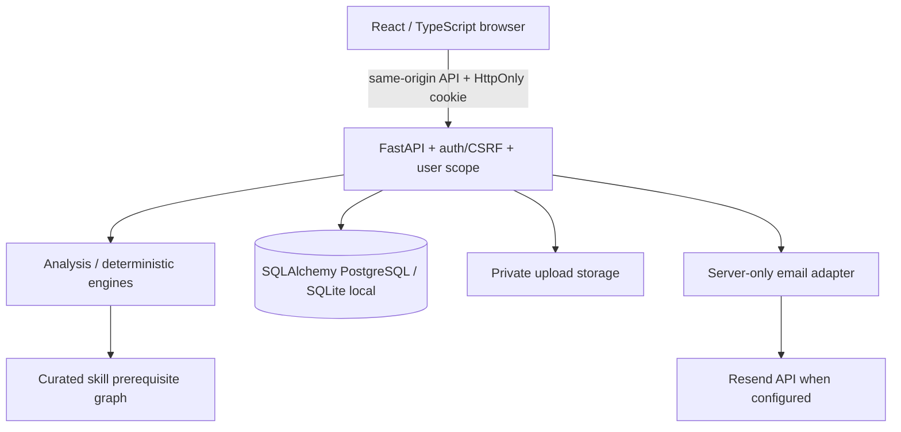
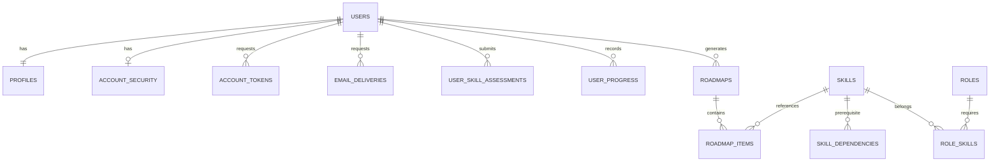

# SkillGraph AI: academic explanation and legal review notes

## Abstract and motivation
SkillGraph AI is an MCA academic career-learning system integrating self-assessed skills, resume evidence, practice, learning and project activity into a role-oriented skill profile. It identifies skill gaps, orders learning work around prerequisites, explains priorities, and persists progress. Its principal recommender is deterministic, not a deployed trained neural recommender. Its contribution is a reproducible integration of evidence, graph constraints, explanations, calibration and recall, rather than a claim to invent personalized learning.

## Problem statement
A learner's evidence can be spread across documents and activities while a target role requires a structured set of skills. The application helps the learner compare that evidence to a curated role and choose a prerequisite-ready next action. It cannot establish professional competence or guarantee employment.

## Research foundation and scope of gap
Educational recommendation and evaluation are already established research areas. Pal and Dahiya's 2023 review discusses course selection, recommendation approaches and evaluation measures; it motivates studying guidance quality, but is not evidence that all existing systems lack personalization. [1](https://ijettjournal.org/archive/ijett-v71i4p218)

Verified reference: Neeti Pal and Omdev Dahiya, “A Systematic Literature Review on the Implications of Educational Recommender System in Teaching Learning Environment,” International Journal of Engineering Trends and Technology, 71(4), 203–212, 2023; DOI 10.14445/22315381/IJETT-V71I4P218. Publisher page was read. This focused review is not a comprehensive systematic literature review of SkillGraph's competitors.

Proposed investigation: can a small, inspectable system combine individual evidence and prerequisite constraints into understandable career-oriented next actions? This is a local engineering/research question, not a proven unresolved global research gap.

|Potential limitation to investigate|Actual implementation|Evidence|
|---|---|---|
|Same path despite different learner evidence|Evidence-weighted skill scores and gap recalculation|Personalisation/API tests with profile inputs|
|Unclear prerequisite order|Catalog prerequisite closure, dependency ordering, locked roadmap steps|Engine and locked-step tests|
|Opaque next action|`why_prioritized`, next-best-action explanations and bottleneck panel|Actual roadmap/dashboard payloads and screenshots|
|Progress difficult to retain|Per-user progress and stored roadmap snapshots|Isolation tests and browser reload check|
|Self-confidence differs from demonstrated knowledge|Confidence calibration using scored checks|Intelligence tests; no clinical/psychometric claim|
|Review timing disconnected from learning|Persisted recall schedule|Schedule tests; educational benefit not established|

## Objectives and methodology
1. Represent role skills and directed prerequisites in a curated catalog.
2. Combine evidence conservatively and cap unsupported self-report scores.
3. Compare current scores to role targets and prioritize gaps without violating prerequisites.
4. Expose rationales, bottlenecks and progress through accessible interfaces.
5. Evaluate correctness, input sensitivity, data isolation and lifecycle security reproducibly.

Relevant modules: `engine/catalog.py`, `knowledge.py`, `gap.py`, `roadmap.py`, `intelligence.py`, `services/analysis.py`, `services/views.py`. Gap priorities combine role importance and supporting-skill considerations. Roadmap statuses are derived from scores, completion and prerequisite readiness; completion percentage is completed nodes divided by total nodes, not placement probability. Existing detailed formulas remain in the original README sections below the revision notice.

ML experiments in `ml/sasrec`, `ml/two_tower` and optional semantic helpers are preserved. No training dataset, verified learned-model production deployment, model accuracy or improvement over a baseline is claimed by this revision. No LLM provider is required by the main workflow.

## Architecture / data flow

Conceptual ER diagram; ORM files are authoritative for exact SQL table names, keys and constraints. New account metadata is additive and keyed by the existing UUID user ID. Token consumption uses conditional SQL update for one-time use; no plaintext tokens are persisted. PostgreSQL concurrency still needs independent integration testing.

## Differentiation, not superiority
The implemented integration is inspectable: evidence, prerequisites, rationale, progress and recall share an analysis pipeline. A comparison study with learning platforms or public roadmap tools is PLANNED, not completed. Do not claim they lack these features without inspecting their current behavior and documentation. Suggested criteria: account requirements, evidence input types, explicit prerequisites, personalized ordering, rationale, progress export and data deletion. Record dated product observations before claiming differentiation.

## Reproducible evaluation plan
- Relevance: have two independent reviewers rate next actions for predefined synthetic profiles; report agreement and disagreements. Not performed.
- Prerequisites: check every edge occurs before its dependent in generated paths and locked-step API behavior; existing automated engine/API tests cover curated cases, not every possible custom role.
- Completeness: compare role/prerequisite closure with returned nodes, detect duplicates and unknown references.
- Sensitivity: vary one skill/target role, preserve other inputs, compare scores/order/rationales.
- Persistence: update a step, reload and reauthenticate, compare progress (browser/API checks performed).
- Response time: repeated warm/cold requests with p50/p95 and environment details. No latency benchmark reported.
- Usability: adult volunteers, task completion/time/error counts and consented feedback; planned only.
- Security: positive/negative auth, role checks, reset replay/expiry, mocked emails, data isolation and dependency audits; see test report.
- Compatibility: Chromium emulation at documented widths performed; physical Android/iOS, Safari, Firefox and OS-specific verification not performed.

No participant survey, efficacy experiment, benchmark superiority or statistical significance is invented. Tests establish checked software behavior, not learning effectiveness.

## Legal research: adults-only pilot, not compliance certification
The DPDP Act defines a child as under eighteen and provides for verifiable parental consent and restrictions on children's processing, subject to specified exemptions. This does NOT make 13 a suitable assumed Indian age threshold. [2](https://www.meity.gov.in/static/uploads/2024/06/2bf1f0e9f04e6fb4f8fef35e82c42aa5.pdf)

Government-notified DPDP Rules 2025, G.S.R. 846(E), Rule 1 provides phased commencement: Rules 1, 2 and 17–21 on publication, Rule 4 one year later, and Rules 3, 5–16, 22 and 23 eighteen months later. Do not treat all obligations as simultaneously operational on 1 November 2026. Check the publication date, separate Act commencement notification, corrigenda and subsequent government notifications before a launch. Official Gazette PDF was retrieved; full current applicability of all related laws was NOT independently finalized. [3](https://www.meity.gov.in/static/uploads/2025/11/53450e6e5dc0bfa85ebd78686cadad39.pdf)

Policy decision: only adults may register in normal mode; server validates explicit eligibility and terms acknowledgement, stored with version and timestamps. This is self-attestation, not validated age assurance. No unnecessary date of birth or identity documents are collected. No parental-consent flow is implemented; do not allow minors until properly designed and reviewed. College-project status is NOT treated as an automatic exemption, and educational-institution exemptions must not be assumed applicable to this application.

IT Act/SPDI Rules transition, intermediary status, grievance obligations, breach response and retention need qualified legal review based on the actual operator and commencement schedule. Consumer/e-commerce obligations must be reassessed if payments, placement services or commercial offers are introduced. This revision does not take payment or guarantee employment. No blanket legal-compliance claim is made.

Draft `/terms` and `/privacy` accurately disclose optional profiles, assessments, uploads, database storage, optional email and YouTube processing. Before real public use: publish operator identity/grievance contact; implement accessible withdrawal/deletion requests and an authenticated deletion workflow; approve retention and backup expiry, cross-border vendor terms and incident response. These are explicit release blockers, not satisfied merely by adding a checkbox.

## Future scope and viva notes
Future work: human-reviewed catalog expansion, systematic competitor analysis, trained-model experiments with baselines and reproducible splits, privacy-preserving user evaluation, resilient email outbox/webhooks, complete admin audit trail, practical deletion and retention automation, shared rate limiting, PostgreSQL concurrency suite and multi-browser/device testing.

Viva: Explain why deterministic rules are appropriate for sparse academic data; show a prerequisite edge and why a step locks; show one profile input changing a result; show a progress reload; demonstrate a normal user's 403 on `/admin/users`; explain what tests prove and what they do not. Author, guide, institution and academic year must be filled by the student—no identity is invented.
